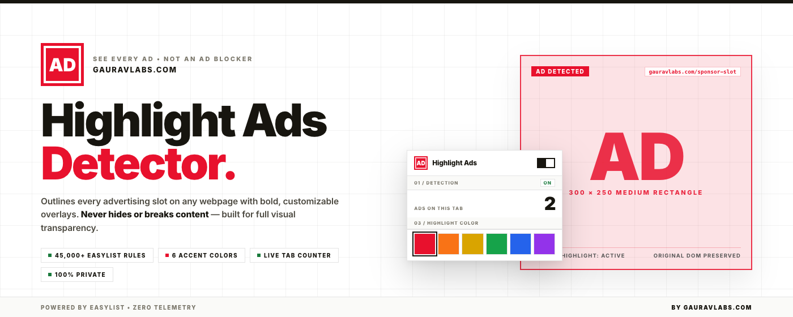

# Highlight Ads Detector

See every ad on the page. Highlights ad slots with a bold overlay and a large
AD marker. Not an ad blocker: it never blocks, hides, or removes ads.

By [gauravlabs.com](https://gauravlabs.com).

## Features

- Automatic detection powered by the community-maintained EasyList filter set,
  refreshed every 4 days (manual refresh included)
- Six highlight colors
- Live ad count on the toolbar badge and in the popup
- Stays glued to sticky banners while scrolling; works on single-page sites
- Offline fallback with bundled patterns when the list can't be reached
- Detects publisher-labeled slots, ad markers, and standard IAB-size slots

## Install

Load the production build (no dev-mode warnings):

```sh
npm install
npm run build
```

Then open `chrome://extensions`, enable Developer mode, and "Load unpacked"
the `.output/chrome-mv3` folder. Or install `highlight-ads-<version>-chrome.zip`
from `.output/`.

For development with hot reload:

```sh
npm run dev
```

## Scripts

| Command         | What it does                          |
| --------------- | ------------------------------------- |
| `npm run dev`   | Start WXT dev mode (auto-reloads)     |
| `npm run build` | Production build into `.output/`      |
| `npm run zip`   | Build + pack the store-ready `.zip`   |
| `npm run compile` | Type-check with `tsc --noEmit`      |
| `npm run promo:capture` | Capture store & promo PNG images |

## How it works

- `entrypoints/highlight.content.ts` — scans the top frame for ad slots
  (frames, media, labeled containers, standard-size iframes), draws
  fixed-position overlays, and reports counts.
- `entrypoints/background.ts` — runs the EasyList engine
  ([@cliqz/adblocker](https://github.com/ghostery/adblocker)), caches the list
  in `chrome.storage.local`, validates payloads before parsing, and answers
  batched classification requests.
- `entrypoints/popup/` — toggle, live count, list status, manual list update,
  and the 6-color picker.
- `utils/` — settings protocol, bundled fallback patterns, EasyList helpers.
- `store-assets/` — icons, promo artwork sources (`promo-page/`), and the
  store listing copy (`listing.txt`).

## Privacy

No user data is collected or transmitted. Detection runs on-device; the only
network request is the periodic download of the public EasyList text file.

## Third-party licenses

- EasyList filter data is fetched at runtime from
  [easylist.to](https://easylist.to) and is **not** bundled with this
  extension. EasyList is licensed under the GPLv3; see the
  [easylist repository](https://github.com/easylist/easylist) for details.
- This extension bundles [@cliqz/adblocker](https://github.com/ghostery/adblocker)
  (Mozilla Public License 2.0) to match filter rules locally.

## License

MIT — see [LICENSE](./LICENSE).
